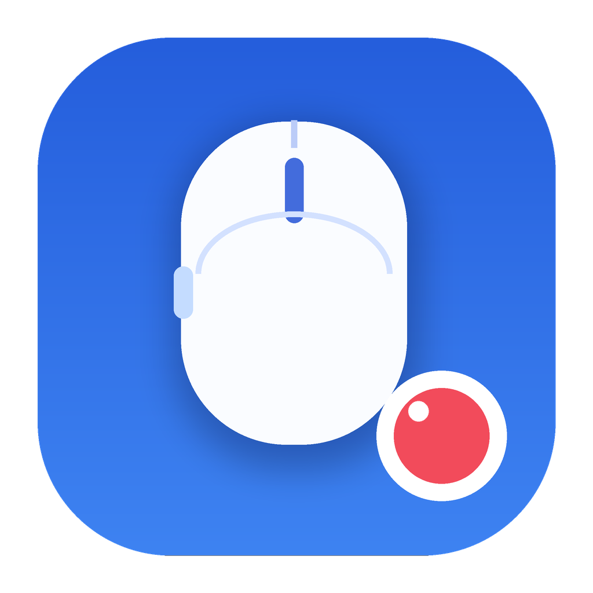
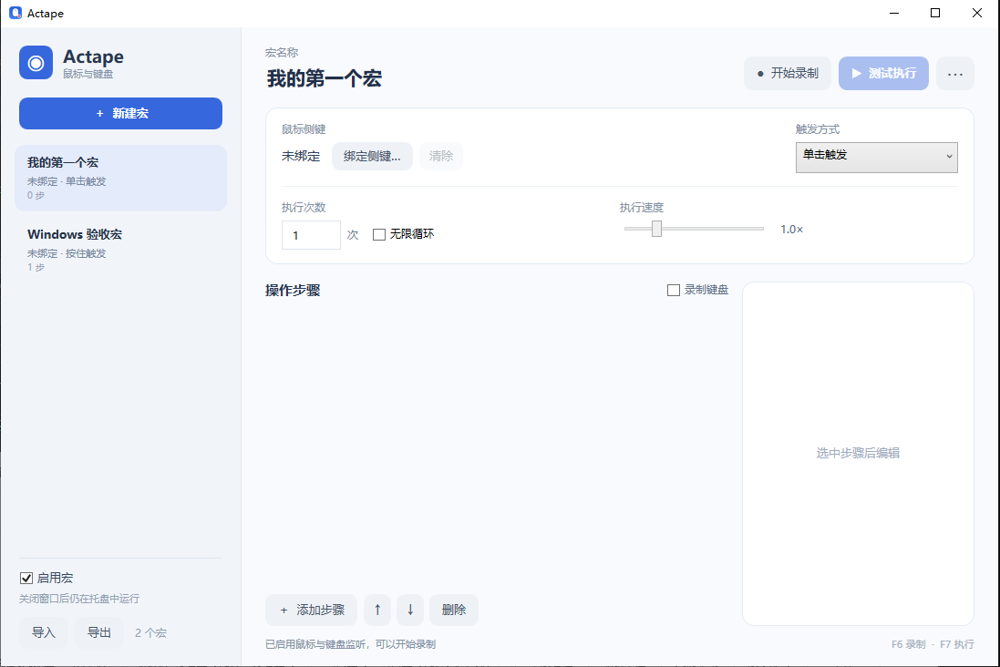

<div align="center">



# Actape

**A lightweight, ready-when-you-need-it mouse and keyboard macro tool.**

[](https://github.com/rizetngan/Actape/actions/workflows/build.yml) [](https://github.com/rizetngan/Actape/actions/workflows/windows-build.yml)  

[简体中文](README.md) · English

[Features](#features) · [macOS](#macos) · [Windows](#windows) · [Download](#download) · [Development](#development)

</div>

<p align="center">

<br><sub>Native Windows interface · Stable v1.0.1</sub>
</p>

Actape is a native macro utility for macOS and Windows. Record repetitive mouse and keyboard actions, edit them as steps, bind a macro to a physical mouse side button, and replay it when needed. **One lightweight app for recording, editing, triggering, and playback—without a separate mouse-remapping utility.**

## Features

- **Quick recording:** Capture system-wide mouse clicks, drags, scrolling, and keyboard input.
- **Editable steps:** Adjust coordinates, buttons, click counts, delays, and order.
- **Side-button triggers:** Bind a macro by pressing a physical mouse side button—no key codes to enter.
- **Fast playback:** Configure repeat count and speed; Windows supports hold-to-repeat and stop-on-release.
- **Macro management:** Create, duplicate, delete, auto-save, and import/export JSON.
- **Global shortcuts:** Use F6 / F7 to start recording and test playback.

## macOS

**Status:** Physical macOS side-button test passed

A native SwiftUI implementation using CoreGraphics to monitor and replay system input events.

- Record mouse clicks, drags, scrolling, and keyboard input.
- Edit steps and configure repeat count and playback speed.
- Bind a physical mouse side button directly; press to run and press again to stop.
- Configurable global F6 / F7 shortcuts.
- JSON import/export and automatic persistence.

The current macOS version supports tap-to-trigger. **Hold-to-repeat with stop-on-release is not implemented yet.**

## Windows

**Status:** Windows v1.0.1 released

A native WPF implementation using Win32 low-level mouse/keyboard hooks and `SendInput`. It is implemented independently from the macOS app and does not require a separate remapping driver.

- Record mouse clicks, drags, and scrolling; keyboard recording is optional.
- Edit coordinates, delays, click counts, keys, and text-input steps.
- Bind standard mouse side buttons XBUTTON1 / XBUTTON2 directly.
- Configure each macro for tap-to-trigger or hold-to-repeat, stopping on release.
- System-tray operation, automatic persistence, and JSON import/export.

Windows v1.0.1 has been released after local build, standalone EXE launch, UI checks, and hands-on testing.

## Download

**Actape v1.0.1 is officially released.** Download installers from [GitHub Releases](https://github.com/rizetngan/Actape/releases/tag/v1.0.1).

- [macOS build and release workflow](https://github.com/rizetngan/Actape/actions/workflows/build.yml)
- [Windows build artifacts](https://github.com/rizetngan/Actape/actions/workflows/windows-build.yml)
- [All releases](https://github.com/rizetngan/Actape/releases)

The official release provides macOS Universal and Windows x64 packages, plus `SHA256SUMS.txt` to verify their integrity.

## Usage

### macOS

1. Download the macOS ZIP from [Releases](https://github.com/rizetngan/Actape/releases/tag/v1.0.1), unzip it, and move Actape.app to Applications.
2. On first launch, grant Actape the required input permission in System Settings → Privacy & Security → Device Control and Data Access (or Accessibility on older macOS versions).
3. Start recording, perform the actions, then stop. Edit the steps and test playback.
4. Bind a mouse side button in the macro details to trigger it directly.

### Windows

1. Launch `Actape.exe`.
2. Create a macro and click Record. Perform the actions after the countdown.
3. Press F6 or click Finish Recording, edit the steps, and click Test.
4. Click Bind Side Button, then press physical mouse button 4 or 5.
5. Choose tap or hold mode. Closing the main window keeps Actape running in the system tray.

## Development

### macOS

Requires Xcode 26.4+ and macOS 26.4+.

```bash
xcodebuild -project Actape.xcodeproj -scheme Actape \
  -configuration Debug -destination 'platform=macOS' \
  CODE_SIGNING_ALLOWED=NO build
```

### Windows

Requires Windows 10/11 and the .NET 10 SDK.

```powershell
dotnet build Windows/Actape.Windows/Actape.Windows.csproj -c Release

dotnet publish Windows/Actape.Windows/Actape.Windows.csproj -c Release -r win-x64 `
  --self-contained true -p:PublishSingleFile=true
```

GitHub Actions builds and publishes the macOS Universal and Windows x64 release packages.

## Data and compatibility

- macOS data: `~/Library/Application Support/Actape/macros.json`
- Windows data: `%APPDATA%\Actape\Windows\macros.json`
- On first launch after upgrading from Macrobot, Actape copies the existing macro file into its new data directory. The legacy file is kept.
- The platforms currently use separate data models; compatible macro data can be moved through JSON import/export.

The macOS app now uses its own Bundle Identifier. Input permissions must be granted again after upgrading.

Some mouse vendors translate side buttons into keyboard events or do not emit standard XBUTTON events. Such devices require model-specific validation. On Windows, a non-elevated process also cannot reliably inject input into elevated windows.

## Credits and license

The original macOS implementation is based on [illixion/MacroBot](https://github.com/illixion/MacroBot) (MIT). The Windows version is an independent native implementation. Thanks to the upstream author and open-source community.

Actape is maintained by [rizetngan](https://github.com/rizetngan). Upstream MIT copyright and license terms are retained.

[MIT License](LICENSE) · [Report an issue](https://github.com/rizetngan/Actape/issues)
