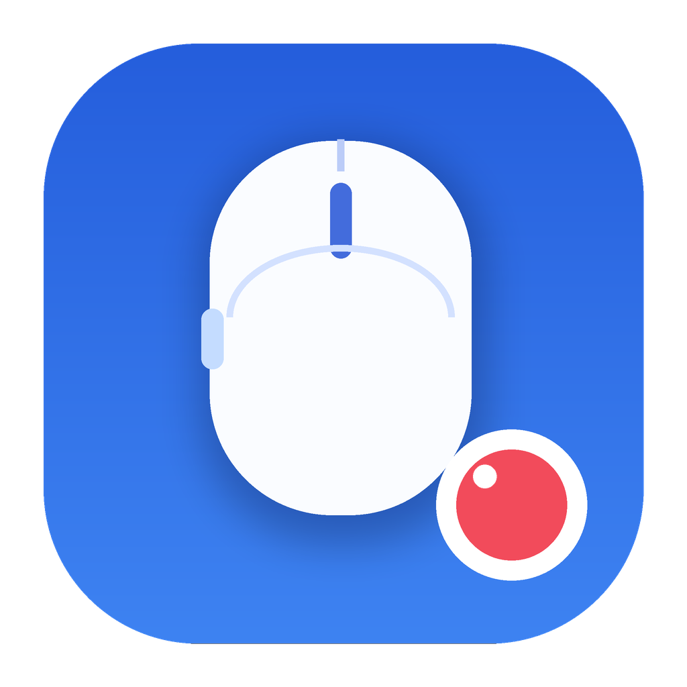
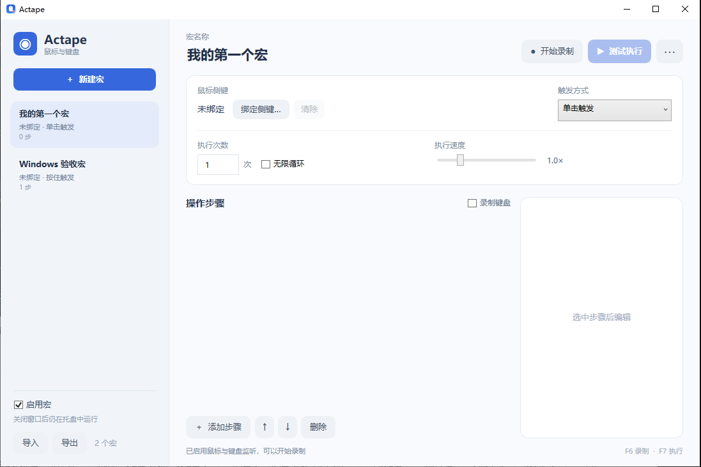

<div align="center">



# Actape

**随录随用的轻量化鼠标与键盘宏工具**

[](https://github.com/rizetngan/Actape/actions/workflows/build.yml) [](https://github.com/rizetngan/Actape/actions/workflows/windows-build.yml)  

简体中文 · [English](README.en.md)

[功能](#功能) · [macOS](#macos) · [Windows](#windows) · [下载安装](#下载安装) · [开发](#开发)

</div>

<p align="center">

<br><sub>Windows 原生界面 · 正式版 v1.0.1</sub>
</p>

Actape 是一款面向 macOS 与 Windows 的原生宏工具。把重复的鼠标和键盘操作录下来，整理成可编辑步骤，再绑定到鼠标侧键随时执行。**一个轻量 App 完成录制、编辑、触发和回放，不需要额外安装鼠标映射软件。**

## 功能

- **随手录制**：系统级捕获鼠标点击、拖动、滚动和键盘操作。
- **步骤编辑**：调整坐标、按键、点击次数、延迟与执行顺序。
- **侧键触发**：直接按下实体鼠标侧键绑定宏，不必手动填写按键编号。
- **快速回放**：配置执行次数与速度；Windows 版支持按住循环、松开停止。
- **宏管理**：新建、复制、删除、自动保存，支持 JSON 导入与导出。
- **全局快捷键**：通过 F6 / F7 快速开始录制与测试执行。

## macOS

**状态：** macOS 实体鼠标侧键测试通过

原生 SwiftUI 实现，使用 CoreGraphics 监听和回放系统级输入事件。

- 录制鼠标点击、拖动、滚动及键盘输入。
- 编辑步骤、设置循环次数与回放速度。
- 直接绑定实体鼠标侧键；按下触发，再次按下停止。
- 全局 F6 / F7 快捷键，可在设置中调整。
- JSON 导入导出与自动保存。

当前 macOS 版本支持侧键单击触发；**按住循环、松开立即停止尚未实现**。

## Windows

**状态：** Windows 正式版 v1.0.1

原生 WPF 实现，使用 Win32 低级鼠标/键盘钩子与 `SendInput`，与 macOS 版本独立实现，不依赖额外驱动映射程序。

- 鼠标点击、拖动、滚动录制；可选录制键盘操作。
- 编辑坐标、延迟、点击次数、按键和文字输入步骤。
- 直接绑定标准鼠标侧键 XBUTTON1 / XBUTTON2。
- 每个宏独立选择单击触发，或按住循环、松开停止。
- 系统托盘常驻、自动保存、JSON 导入导出。

Windows 版已完成本机编译、独立 EXE 启动、界面检查及用户实机测试，现作为 v1.0.1 正式发布。

## 下载安装

**Actape v1.0.1 已正式发布。** 下载安装包请前往 [GitHub Releases](https://github.com/rizetngan/Actape/releases/tag/v1.0.1)。

- [macOS 构建与发布记录](https://github.com/rizetngan/Actape/actions/workflows/build.yml)
- [Windows 构建产物](https://github.com/rizetngan/Actape/actions/workflows/windows-build.yml)
- [全部 Releases](https://github.com/rizetngan/Actape/releases)

正式版提供 macOS Universal 与 Windows x64 安装包。下载后可使用 Release 中的 `SHA256SUMS.txt` 校验文件完整性。

## 使用方法

### macOS

1. 从 [Releases](https://github.com/rizetngan/Actape/releases/tag/v1.0.1) 下载 macOS ZIP，解压后将 Actape.app 放入「应用程序」文件夹。
2. 首次启动后，在「系统设置 → 隐私与安全性」中为 Actape 授予「设备控制和数据访问」或旧版系统中的「辅助功能」权限。
3. 点击录制，完成操作后停止录制；编辑步骤并测试执行。
4. 在宏详情中绑定鼠标侧键，之后即可直接触发宏。

### Windows

1. 启动 `Actape.exe`。
2. 新建宏，点击「开始录制」，在倒计时结束后执行要录制的操作。
3. 按 F6 或点击「完成录制」，编辑步骤并点击「测试执行」。
4. 点击「绑定侧键…」，直接按下鼠标侧键 4 或 5。
5. 为该宏选择单击或按住模式；关闭主窗口后应用会留在系统托盘。

## 开发

### macOS

要求 Xcode 26.4+ 与 macOS 26.4+。

```bash
xcodebuild -project Actape.xcodeproj -scheme Actape \
  -configuration Debug -destination 'platform=macOS' \
  CODE_SIGNING_ALLOWED=NO build
```

### Windows

要求 Windows 10/11 与 .NET 10 SDK。

```powershell
dotnet build Windows/Actape.Windows/Actape.Windows.csproj -c Release

dotnet publish Windows/Actape.Windows/Actape.Windows.csproj -c Release -r win-x64 `
  --self-contained true -p:PublishSingleFile=true
```

GitHub Actions 分别负责 macOS Universal 和 Windows x64 正式版本构建与发布。

## 数据与兼容

- macOS 数据：`~/Library/Application Support/Actape/macros.json`
- Windows 数据：`%APPDATA%\Actape\Windows\macros.json`
- 从旧版 Macrobot 升级时，首次启动会将原有宏文件复制到 Actape 的新目录，旧文件保留不删除。
- 两个平台目前使用各自的数据模型；可通过 JSON 导入导出迁移兼容的宏数据。

macOS 更换了独立 Bundle Identifier，升级后首次使用需要重新授予系统输入权限。

部分鼠标厂商会将侧键转换为键盘事件，或不向系统发送标准 XBUTTON 事件；此类设备需要按具体型号验证。Windows 普通权限进程也无法可靠向管理员权限窗口注入输入。

## 致谢与许可

macOS 原始实现基于 [illixion/MacroBot](https://github.com/illixion/MacroBot)（MIT）继续开发；Windows 版本为独立的原生实现。感谢上游作者及开源社区。

Actape 由 [rizetngan](https://github.com/rizetngan) 维护。项目保留上游 MIT 版权与许可要求。

[MIT License](LICENSE) · [问题反馈](https://github.com/rizetngan/Actape/issues)
