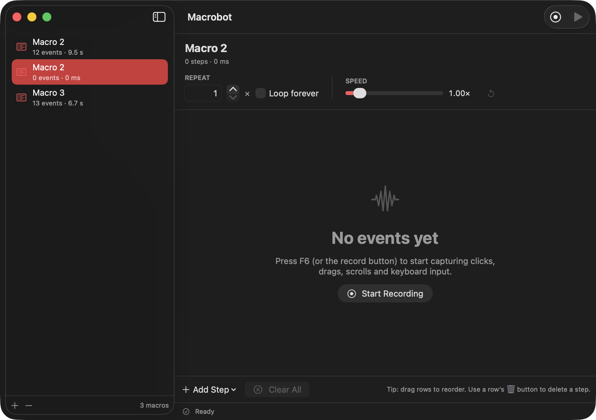

# Macrobot

A lightweight macOS app for recording and replaying mouse + keyboard macros. It
captures global input via a `CGEventTap` and plays it back with `CGEvent.post`,
so it can drive any app — not just itself.



## Features

- **Record clicks, drags, scrolls, and keystrokes** system-wide with one hotkey.
- **Clean, editable steps.** Recordings collapse into readable steps you can edit
  inline — adjust coordinates, buttons, click counts, delays, or reorder by drag.
- **Smart click capture.** A quick press becomes a single *Click* step (which
  always releases promptly, even when slowed down); a long press stays a real
  press-and-hold; movement is recorded as a drag.
- **Adjustable playback.** Set a repeat count or loop forever, and scale the whole
  macro's speed from 0.1× to 10×.
- **Programmable "Type Text" steps** with an auto-incrementing counter — numbers or
  24-hour timestamps (e.g. type `0000`, `0015`, `0030`… once per loop), with an
  optional stop time that halts the run.
- **Configurable global shortcuts** for record and play (default **F6** / **F7**).
- **Import / export** macros as JSON, and automatic persistence between launches.

## Download

Grab the latest build from the [**Releases**](../../releases) page —
`Macrobot-*.zip` is a universal (Apple Silicon + Intel) app.

The build is ad-hoc signed but **not notarized**, so Gatekeeper will warn on first
launch. To open it:

1. Unzip and move `Macrobot.app` to `/Applications`.
2. Right-click the app → **Open** → **Open** (once), or run
   `xattr -dr com.apple.quarantine /Applications/Macrobot.app`.

## Permissions

Macrobot needs **Accessibility** access to observe and post events — a sandboxed
app can't create a session-level event tap. On first launch it shows a banner;
click it to open **System Settings → Privacy & Security → Accessibility** and
enable Macrobot. The app re-checks every couple of seconds, so the banner clears
as soon as you grant access.

## Default shortcuts

| Action            | Shortcut | Menu             |
| ----------------- | -------- | ---------------- |
| Toggle recording  | **F6**   | ⌘⇧R              |
| Toggle playback   | **F7**   | ⌘⇧P              |
| New macro         | —        | ⌘N               |
| Import macros     | —        | ⌘O               |
| Export selected   | —        | ⌘⇧E              |

The two global shortcuts are configurable in **Settings (⌘,)**. Function keys are
recommended — a shortcut's key can't be captured while you're recording.

## Building from source

Requires Xcode 26.4+ (macOS Tahoe).

```sh
# Open in Xcode and run, or build from the command line:
xcodebuild -project Macrobot.xcodeproj -scheme Macrobot \
  -configuration Debug -destination 'platform=macOS' build
```

The Xcode project uses a file-system-synchronized group, so anything added under
`Macrobot/` is included automatically — no `project.pbxproj` edits needed.

Pushes to `main` build a universal release via GitHub Actions and publish the
zipped app to Releases (see [`.github/workflows/build.yml`](.github/workflows/build.yml)).

## How it works

| Area | File |
| ---- | ---- |
| Recording (listen-only event tap, click coalescing) | [`EventRecorder.swift`](Macrobot/Recording/EventRecorder.swift) |
| Playback (detached loop, speed scaling, drag interpolation) | [`EventPlayer.swift`](Macrobot/Playback/EventPlayer.swift) |
| Global hotkeys (Carbon `RegisterEventHotKey`) | [`Hotkeys/`](Macrobot/Hotkeys/) |
| Model (`Macro`, `MacroEvent`) | [`Models/`](Macrobot/Models/) |
| Storage + import/export | [`MacroStore.swift`](Macrobot/Store/MacroStore.swift) |
